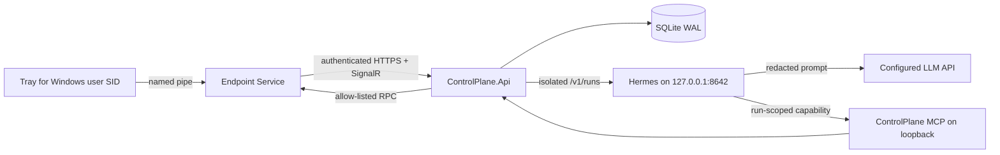

# Isolated Hermes Support Agent

## Authority boundary

Hermes is a reasoning worker, not the routing or authorization boundary.
`ControlPlane.Api` owns device identity, Windows-user identity, conversations,
message delivery, consent, command allow-listing, and audit data.



Hermes never receives an `agentId` tool argument and never sends a response to
an endpoint. Each random run capability resolves server-side to one active run,
conversation, authenticated device, and user SID. The final assistant message
is committed to SQLite before the run is marked complete. The Tray retrieves
only its own sequence delta while its chat view is visible.

## Implemented surfaces

- One-time enrollment codes and random device bearer tokens. Only token hashes
  are stored by ControlPlane; endpoints protect credentials with machine-scoped
  DPAPI.
- Conversations keyed by authenticated device ID and Windows user SID.
- Idempotent user turns through unique client message IDs and monotonic
  per-conversation sequences.
- Durable queued/running/completed/failed runs in SQLite WAL mode. Interrupted
  running rows are safely re-queued during ControlPlane startup.
- Four concurrent conversations by default, with one active run per
  conversation and a fifteen-minute run timeout.
- A unique Hermes session per run. ControlPlane supplies the bounded
  conversation history and removes the Hermes session after reconciliation, so
  Hermes is not the conversation store.
- Loopback MCP endpoint at `/internal/mcp`, protected by a separate bearer key.
- Read-only diagnostics plus immutable, single-use action proposals. Generic
  proposals never run a command; the same endpoint user must approve them in
  the Tray. The dedicated Windows and Office activation workflows instead run
  their pinned approved repairs automatically after their safety checks and verify
  activation again. Direct operator dispatch keeps its Tray consent gate.
- Thirty-day cleanup for completed conversation data; devices and their
  revocation state are retained.

## Local development settings

Local ControlPlane values are stored in
`src/ControlPlane.Api/appsettings.Development.json`. They include the local
SQLite path, Hermes loopback URL, development API/MCP keys, and relaxed local
HTTP/authentication switches. Start the API without temporary environment
variables:

```powershell
dotnet run --project src\ControlPlane.Api\ControlPlane.Api.csproj
```

The development Hermes API and MCP keys in that file must exactly match the
selected Hermes profile. They are test credentials only; replace them in the
installed production `appsettings.json` and never reuse them outside localhost.
The relative development SQLite path is resolved against the API project root,
so the command works regardless of the shell's current directory.

`Chat:MaxVisibleItems` controls the rolling tray transcript (30 cards by
default) without deleting stored conversation data. `Hermes:MaxHistoryMessages`
controls the separate model context window (5 messages by default, including
the current request).

### Development Hermes profile and skill sync

On a development PC, run Hermes as its own profile so personal Hermes use stays untouched:

```powershell
hermes profile create endpointagents --no-skills --no-alias
.\scripts\sync-hermes-profile.ps1 -Provision   # first time: config.yaml, .env, skills, SOUL.md
hermes -p endpointagents gateway run           # serves 127.0.0.1:8642
```

`-Provision` takes the API-server and MCP keys from `appsettings.Development.json` and
copies only the LLM provider key from the default profile.

Hermes only sees reviewed assets after they are copied into that profile. After **every**
change to `deploy/hermes/SOUL.md` or to a promoted skill (`office-support`,
`windows-support`, `system-info`), run `.\scripts\sync-hermes-profile.ps1` and restart the gateway.
`.\scripts\sync-hermes-profile.ps1 -Check` reports whether the profile is current and
exits 1 when it is not.
## Production installation

### 1. Install ControlPlane and configure HTTPS

Run from an elevated PowerShell session:

```powershell
.\scripts\install-control-plane.ps1
```

Keep `C:\ProgramData\EndpointAgents\ControlPlane` on a BitLocker- or
equivalently encrypted server volume. The installer restricts the data tree to
SYSTEM and Administrators, but it does not enable volume encryption.

Configure Kestrel with a trusted server certificate before enrolling endpoints.
The production setting `AgentSecurity:RequireHttps=true` rejects remote
enrollment, SignalR, and artifact traffic over HTTP. Keep the operator dashboard
and operator APIs on loopback. A reverse proxy requires an explicit trusted
forwarded-header configuration first; that is not enabled by the default
application profile.

Do not enable `AgentSecurity:RequireAuthentication` until the staged endpoint
enrollment described below is complete.

### 2. Install a pinned Hermes runtime

Use Hermes's native Windows installer with an explicit release tag or commit,
an installation directory under Program Files, and no automatic update job.
The exact release must first pass the test matrix for this repository.

Example shape (replace the pin):

```powershell
$installer = Invoke-RestMethod `
  https://raw.githubusercontent.com/NousResearch/hermes-agent/main/scripts/install.ps1
& ([scriptblock]::Create($installer)) `
  -Tag 'vX.Y.Z' `
  -SkipSetup `
  -HermesHome 'C:\ProgramData\EndpointAgents\Hermes' `
  -InstallDir 'C:\Program Files\EndpointAgents\HermesRuntime'
```

The native installer and supported pinning parameters are documented in the
[Hermes Windows guide](https://hermes-agent.nousresearch.com/docs/user-guide/windows-native).

Install a reviewed, pinned NSSM build, then configure the service:

```powershell
$providerKey = Read-Host 'LLM provider API key' -AsSecureString
.\scripts\install-hermes-service.ps1 `
  -HermesExecutable 'C:\Program Files\EndpointAgents\HermesRuntime\venv\Scripts\hermes.exe' `
  -ExpectedVersion 'X.Y.Z' `
  -NssmPath 'C:\Program Files\nssm\win64\nssm.exe' `
  -ProviderEnvironmentName 'OPENROUTER_API_KEY' `
  -ModelProvider 'openrouter' `
  -ModelId 'YOUR-REVIEWED-AGENT-CAPABLE-MODEL' `
  -ProviderApiKey $providerKey
```

The script:

- verifies the expected Hermes version and refuses an existing service;
- pins the configured provider and model for new Hermes sessions;
- generates different random API-server and MCP bearer secrets;
- synchronizes those secrets into ControlPlane's protected settings;
- runs Hermes as the low-privilege virtual account
  `NT SERVICE\EndpointAgents.Hermes`;
- binds the API server only to `127.0.0.1:8642`;
- starts both services and verifies run-submission and stop capabilities.

Hermes configuration follows its documented
[API-server bearer/bind settings](https://hermes-agent.nousresearch.com/docs/user-guide/features/api-server/),
[dynamic MCP toolset](https://hermes-agent.nousresearch.com/docs/reference/toolsets-reference),
and [MCP allow-listing](https://hermes-agent.nousresearch.com/docs/reference/mcp-config-reference).

The production API profile contains `mcp-controlplane` and the Hermes `skills`
toolset. Global
defense-in-depth disables terminal, files, browser, web, memory, session search,
learning/curation, cron, delegation, code execution, computer use, and other
unrelated toolsets.

Reviewed source templates live in `deploy/hermes/skills`. ControlPlane does not
read, copy, parse, or manage these files at runtime. An authorized administrator
reviews changes in Git and manually imports or copies the approved skill folders
into the dedicated Hermes profile. Hermes is then the live skill-management
surface. Endpoint runs may list and view relevant skills, but their system
instructions prohibit skill modification; Hermes also stages model-requested
writes for administrator approval.

The reviewed profile identity and shared behavior live in
`deploy/hermes/SOUL.md`. Before deploying ControlPlane, stop Hermes and copy that
file to `C:\ProgramData\EndpointAgents\Hermes\SOUL.md`. ControlPlane sends only
run-specific capability and retry data; it does not read or synchronize
`SOUL.md` at runtime.

Promote the reviewed `office-support`, `windows-support`, `repair-packages` and `software-install` skills. The Windows skill
allows general Windows intake but restricts automated remediation to activation.

Do not promote `ibsng-support` until IBSng tools and actions are deliberately
enabled in the profile and ControlPlane allowlists. Skill text cannot grant a
tool permission that ControlPlane or the Hermes MCP allowlist has withheld.

When using the service layout from this guide, the manual filesystem target is
`C:\ProgramData\EndpointAgents\Hermes\skills`. Stop Hermes, replace only the
reviewed `office-support`, `windows-support`, `repair-packages` and `software-install` skill folders, then start Hermes
and verify that all four appear in the selected API-server profile and that the
profile uses the promoted `SOUL.md`. The same promotion can be performed through
Hermes Desktop if it manages that exact profile.

### 3. Enroll endpoint devices

Create one enrollment code per endpoint from a loopback administrator session:

```powershell
$issue = Invoke-RestMethod -Method Post `
  -Uri 'http://127.0.0.1:5052/api/agent-enrollments'
$issue
```

Install or update the endpoint with its one-time code and the production HTTPS
hub URL:

```powershell
.\scripts\install-endpoint.ps1 `
  -ControlPlaneHubUrl 'https://controlplane.example/agent-hub' `
  -EnrollmentCode $issue.enrollmentCode
```

The Service redeems the code over HTTPS, stores the DPAPI-protected credential
in the SYSTEM/Administrators-only
`C:\ProgramData\EndpointAgents\Credentials` directory, and authenticates
SignalR through `AccessTokenProvider`.

After all supported endpoint versions are enrolled and visible, set:

```json
{
  "AgentSecurity": {
    "RequireAuthentication": true,
    "RequireHttps": true
  }
}
```

Restart `EndpointAgents.ControlPlane.Api`, verify coverage, and remove the
legacy support-request path only after older endpoint versions are retired.
Revoke a compromised device from a loopback administrator session:

```powershell
Invoke-RestMethod -Method Post `
  -Uri 'http://127.0.0.1:5052/api/devices/DEVICE-ID/revoke'
```

## LLM privacy

Hermes runs locally, but the configured LLM provider receives each prompt,
bounded conversation history, tool schemas, and any sanitized tool results.
ControlPlane masks known bearer/credential patterns, endpoint identity values,
SIDs, raw IPv4 addresses, usernames, and machine names before run submission.
Tool results get the same masking, with one deliberate exception: `endpoint_system_info`
keeps IP addresses (adapter IP, subnet, gateway, DNS, DHCP server) because diagnosing
the network is its purpose; identifiers such as machine and user names are still masked.
This is risk reduction, not a mathematical guarantee that free-form user text
contains no personal data. Obtain the appropriate organizational approval,
configure the provider's retention/privacy terms, and do not send unnecessary
logs.

## Consent and action lifecycle

Only these tools are visible to Hermes:

- `endpoint_get_info`
- `endpoint_system_info`
- `windows_activation_status`
- `run_windows_activation_repair`
- `office_inventory`
- `office_activation_status`
- `office_runtime_status`
- `run_office_activation_repair`
- `find_repair_packages`
- `run_repair_package`
- `list_repair_attempts`
- `propose_endpoint_action`
- `mark_problem_resolved`
- `escalate_to_helpdesk`
- `record_feature_request`

`mark_problem_resolved` only sets the run's own conversation to Resolved. The skills ask the user
whether the problem is solved and call it only after a clear yes; a later user message reopens
the conversation. It changes nothing on the endpoint.

The dedicated Windows repair tool supplies only the fixed Windows activation artifact.
The dedicated Office repair tool accepts only a cataloged, version-compatible artifact
ID. Both dispatch filename-and-SHA-pinned commands to the endpoint and user bound to the
run capability and create no approval card. The Windows endpoint repeats its activation
check before execution; the Office endpoint also checks again that Office applications
are closed.

`find_repair_packages` lists the published schema 2 repair packages (id, problem, try
order, display name, description, symptoms, Windows range, and whether it already ran in
this conversation). `run_repair_package` accepts one of those ids, pins its file, playbook
and supporting-file hashes, and dispatches `system.package_run` to the bound endpoint
without an approval card: every package is administrator-reviewed, and the endpoint runs
only the playbook's fixed arguments and answers. See `docs/bat-packages.md`.

### Fallback repairs and escalation

One problem can have several approved repairs (several activation repairs compatible with
the PC, or several packages with the same `problem`). Every repair tool records an attempt
in the conversation's helpdesk timeline. The skills run the first untried repair in
administrator order, ask whether the problem is solved, and on a "no" run the next one;
`list_repair_attempts` tells them what already ran. When nothing untried is left, nothing
fits, or the user asks for a person, `escalate_to_helpdesk` moves the conversation to the
**Escalated** status with a one-line reason and a short summary. Escalated conversations
sort first in the dashboard Helpdesk tab, show the reason, summary and every attempt, and
are never removed by retention until someone resolves them. Escalation changes nothing on
the endpoint.

The generic proposal tool accepts only cataloged Office and Windows remediation
methods. It stores the exact method and parameters with the run, conversation,
endpoint, SID, expiry, and pending state. A decision is immutable and single-use.
Approval dispatches the stored command, never user- or model-supplied replacement
parameters.

## Verification checklist

Run the automated suite:

```powershell
dotnet test .\EndpointAgents.slnx -c Release
```

Before broad rollout, also verify:

1. Two endpoints sending identical prompts cannot read each other's messages
   or tool results.
2. Two Windows SIDs on one endpoint receive separate conversations.
3. Forged device IDs, revoked tokens, foreign conversation IDs, reused run
   capabilities, and reused action decisions fail.
4. ControlPlane/Hermes restart, endpoint reconnect, offline delivery, timeout,
   and the Hermes stop endpoint behave correctly.
5. Prompt injection cannot activate a built-in Hermes toolset, select an
   unauthorized action, or address a different endpoint.
6. In-scope Windows/Office responses are simple Persian; unrelated and ambiguous
   prompts receive the fixed Persian refusal or clarification without invoking
   Hermes.
7. Four active runs and at least 500 SignalR connections remain stable.

Inspect `C:\ProgramData\EndpointAgents\Hermes\logs` and the ControlPlane Windows
service log during testing. Do not log run capabilities, device tokens, or LLM
provider keys.

## Controlled improvement

Production endpoint conversations never edit skills or memory. Edit proposed
skill revisions under `deploy/hermes/skills`, review and test the Git diff, and
then manually promote the approved folders to the dedicated Hermes profile.
Keep skill-write approval enabled so any model-requested write is staged rather
than applied automatically. Cross-user memory remains disabled.
